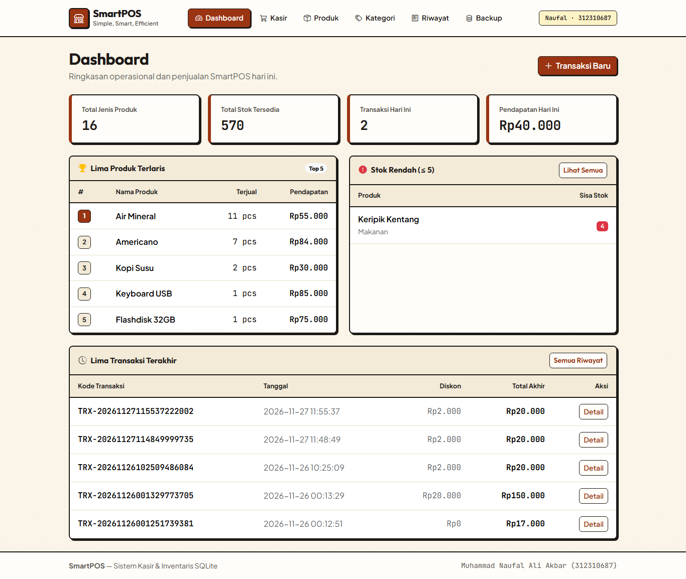
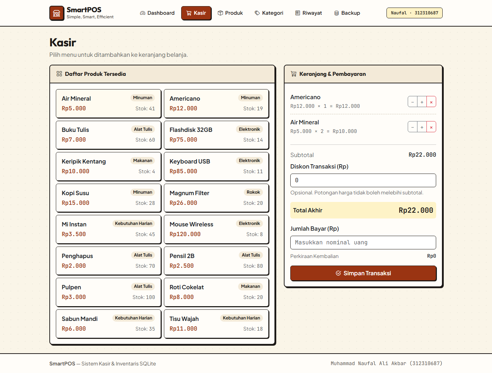
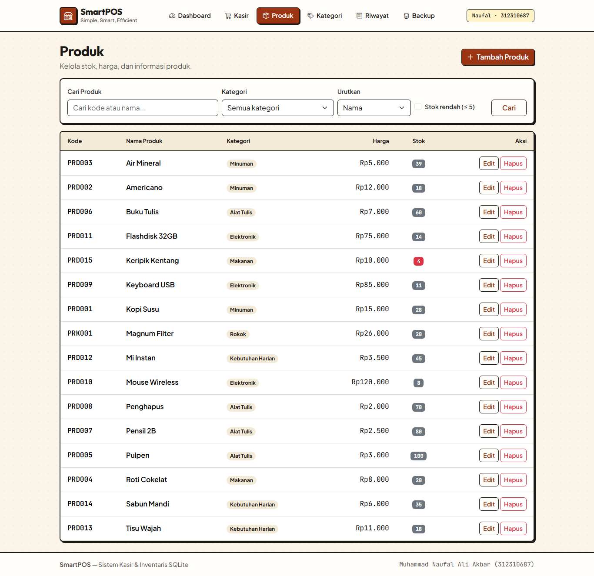
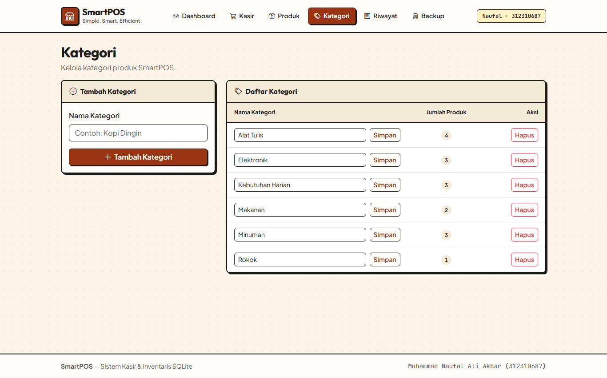
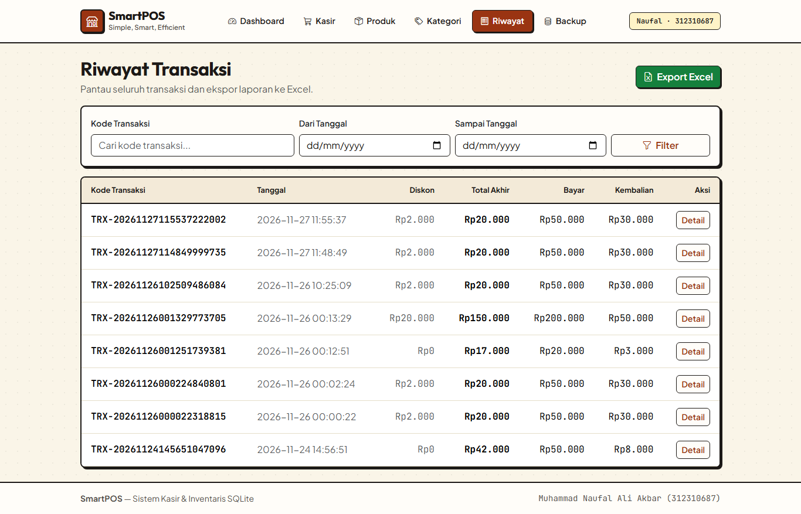
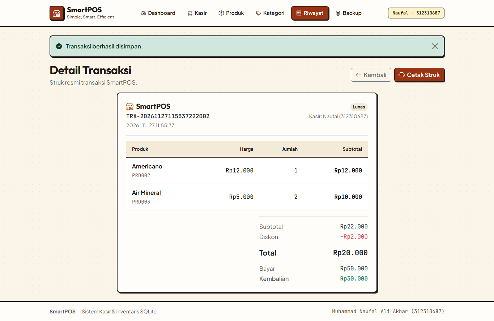
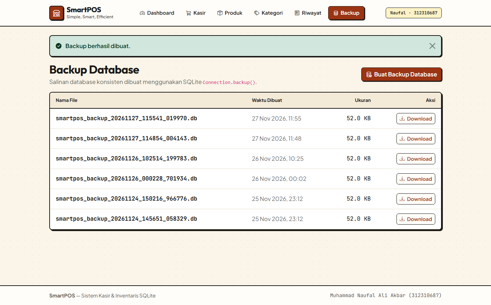

# SmartPOS (Warm Edition) — Flask & SQLite

Aplikasi Point of Sale (POS) berbasis web untuk manajemen kasir, inventaris produk, riwayat transaksi, ekspor laporan Excel, dan pencadangan database menggunakan **Python**, **Flask**, dan **SQLite (`sqlite3`)** dengan tema visual **Warm Tone**.

## Identitas Pengembang
- **Nama Aplikasi:** SmartPOS (Warm Edition)
- **Nama:** Muhammad Naufal Ali Akbar
- **NIM:** 312310687
- **Mata Kuliah:** Automation System — Pengembangan SmartPOS

---

## Fitur Utama & Pengembangan Tambahan

### Fitur Bawaan yang Dipertahankan
- Manajemen Kategori (Tambah, Ubah, Hapus dengan proteksi relasi).
- Manajemen Produk (CRUD, pencarian kata kunci, filter kategori, filter stok rendah $\le 5$, pengurutan, validasi kode produk unik).
- Kasir interaktif dengan keranjang belanja dan validasi stok/pembayaran.
- Riwayat Transaksi, filter kode/tanggal, dan cetak struk.
- Export laporan penjualan ke Microsoft Excel (`.xlsx`).
- Backup database aman menggunakan `sqlite3.Connection.backup()`.

### Pengembangan Tambahan
1. **Lima Produk Terlaris di Dashboard:** Menampilkan peringkat 5 produk dengan penjualan tertinggi menggunakan agregasi SQL (`SUM()`, `GROUP BY`, `ORDER BY`, `LIMIT 5`) dari `detail_transaksi`.
2. **Diskon Transaksi (Validasi Server-Side):** Penambahan kolom `diskon` pada tabel `transaksi`, input diskon pada halaman Kasir, serta validasi ketat di backend (`diskon >= 0`, `diskon <= subtotal`, perhitungan ulang `total_harga` dan `kembalian` di server). Nilai diskon ditampilkan di struk, riwayat transaksi, dan file Excel.
3. **Worksheet "Rekap per Produk" pada Export Excel:** Menambahkan sheet ke-3 bernama `Rekap per Produk` yang merangkum jumlah terjual dan total pendapatan per produk sesuai filter tanggal yang sedang aktif.
4. **Identitas Visual SmartPOS (Warm Tone):** Sistem desain konsisten dengan palet warna *Espresso, Caramel, Cream,* dan *Sand*, tipografi `Plus Jakarta Sans` & `JetBrains Mono`, responsif pada layar laptop/mobile, konfirmasi penghapusan, serta *empty state* di seluruh daftar.

---

## Perubahan Database (`schema.sql` & `init_db.py`)

Penambahan kolom `diskon` pada tabel `transaksi` di `schema.sql`:
```sql
CREATE TABLE IF NOT EXISTS transaksi (
    id INTEGER PRIMARY KEY AUTOINCREMENT,
    kode_transaksi TEXT NOT NULL UNIQUE,
    tanggal_transaksi TEXT NOT NULL,
    diskon INTEGER NOT NULL DEFAULT 0 CHECK (diskon >= 0),
    total_harga INTEGER NOT NULL CHECK (total_harga >= 0),
    jumlah_bayar INTEGER NOT NULL CHECK (jumlah_bayar >= total_harga),
    kembalian INTEGER NOT NULL CHECK (kembalian >= 0)
);
```
Script `init_db.py` bersifat **idempotent**: aman dijalankan berulang kali tanpa menduplikasi data kategori/produk (`INSERT OR IGNORE`) dan otomatis menambahkan kolom `diskon` jika database lama belum memilikinya.

---

## Query SQL Penting

1. **Lima Produk Terlaris (`app.py` — `dashboard()`):**
   ```sql
   SELECT d.produk_id, d.nama_produk,
          SUM(d.jumlah) AS total_terjual,
          SUM(d.subtotal) AS total_pendapatan
   FROM detail_transaksi d
   GROUP BY d.produk_id, d.nama_produk
   ORDER BY total_terjual DESC, total_pendapatan DESC
   LIMIT 5
   ```
   *Penjelasan:* Mengakumulasi total kuantitas dan pendapatan per produk dari `detail_transaksi`, lalu mengurutkan dari yang paling laris sebanyak 5 baris.

2. **Rekapitulasi Penjualan per Produk (`app.py` — `export_excel()`):**
   ```sql
   SELECT d.nama_produk, SUM(d.jumlah) AS jumlah_terjual, SUM(d.subtotal) AS total_pendapatan
   FROM detail_transaksi d
   INNER JOIN transaksi t ON t.id = d.transaksi_id
   WHERE ...
   GROUP BY d.produk_id, d.nama_produk
   ORDER BY jumlah_terjual DESC, total_pendapatan DESC
   ```
   *Penjelasan:* Menggabungkan `detail_transaksi` dengan `transaksi` menggunakan `INNER JOIN` agar rekap penjualan per produk mengikuti filter tanggal/kode transaksi yang dipilih.

---

## Cara Instalasi dan Menjalankan

### Windows (PowerShell / CMD)
```powershell
python -m venv venv
.\venv\Scripts\Activate.ps1
pip install -r requirements.txt
python init_db.py
python app.py
```

### macOS / Linux (Terminal)
```bash
python3 -m venv venv
source venv/bin/activate
pip install -r requirements.txt
python3 init_db.py
python3 app.py
```

Buka browser dan akses **`http://127.0.0.1:5000`**.

---

## Cara Menguji

Seluruh 14 skenario pengujian otomatis tersedia di `tests/test_smartpos.py`. Jalankan perintah berikut:
```bash
python -m pytest -v
```
Hasil lengkap pengujian tercatat di [docs/bukti_pengujian.md](docs/bukti_pengujian.md).

---

## Tangkapan Layar (Screenshots)

| Halaman | Preview |
|---|---|
| **Dashboard** (Statistik & 5 Produk Terlaris) |  |
| **Kasir** (Keranjang & Input Diskon) |  |
| **Produk** |  |
| **Kategori** |  |
| **Riwayat Transaksi** |  |
| **Detail Struk Transaksi** |  |
| **Backup Database** |  |

---

## Kendala dan Solusi
- **Kendala 1: Database lama belum memiliki kolom `diskon`.**  
  *Solusi:* Menambahkan pengecekan `PRAGMA table_info(transaksi)` di `init_db.py` agar kolom `diskon` ditambahkan secara otomatis dengan `ALTER TABLE` tanpa menghapus data transaksi yang sudah ada.
- **Kendala 2: Perhitungan diskon di browser bisa dimanipulasi.**  
  *Solusi:* Perhitungan di `static/js/script.js` hanya bersifat pratinjau UI; seluruh validasi (`0 <= diskon <= subtotal`) serta perhitungan `total_harga` dan `kembalian` dijalankan ulang secara mutlak di `app.py` menggunakan harga resmi dari database.

---

## Pembagian Tugas
- **Individu:** Muhammad Naufal Ali Akbar (NIM 312310687) — Perancangan skema database, pengembangan backend Flask & SQLite, perancangan antarmuka *Warm Tone* SmartPOS, pengujian 14 skenario `pytest` + Playwright, serta penyusunan dokumentasi.
